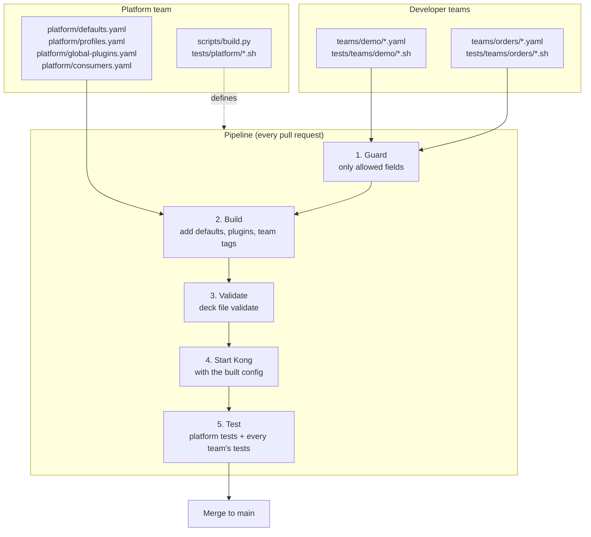

# kong-ci-demo

A demo of a team-friendly API gateway setup on **Kong (free, DB-less)** with a **GitHub Actions** pipeline.

What it shows:

- **A developer needs the minimum** to publish an endpoint: a name, a backend URL and a path.
- **Developers don't know about plugins, security or governance.** The platform team adds them.
- **Routes are private by default.** Making one public is an explicit, visible choice.
- **The platform changes security for every team at once**, without touching a single team file.
- **Many teams work in parallel** on the same gateway without touching each other's files.
- **Every change is tested on a real Kong** before it reaches `main`.

---

## How it works



1. **Guard:** `build.py` reads every `teams/<team>/*.yaml` and rejects anything outside the developer contract (see below).
2. **Build:** it adds the platform defaults (timeouts, retries, `strip_path`), attaches plugins according to each route's access profile, adds the global plugins, tags everything with `team:<team>`, and adds the consumers. The result is a single `build/kong.yaml`. It's generated and never committed.
3. **Validate:** decK checks the built file against Kong's schema, offline.
4. **Start Kong:** a fresh DB-less Kong and a test backend ([httpbin](https://github.com/mccutchen/go-httpbin)) start with exactly the config that was built.
5. **Test:** `tests/run.sh` runs the platform guarantees, then every team's tests, against the running Kong.

The pull request can only be merged when every step is green.

---

## Repository layout and ownership

```
teams/
  <team>/*.yaml           developer team: services and routes
tests/
  teams/<team>/*.sh       developer team: tests for its endpoints
  platform/*.sh           platform team: guarantees for every service
  lib.sh, run.sh          platform team: test helpers and runner
platform/
  defaults.yaml           platform team: settings for every service and route
  profiles.yaml           platform team: which plugins each access profile gets
  global-plugins.yaml     platform team: plugins on every request
  consumers.yaml          platform team: who may call private routes
scripts/build.py          platform team: guard and build
.github/workflows/        platform team: the pipeline
docker-compose.yaml       Kong + test backend, used locally and in CI
```

A team only ever touches `teams/<team>/` and `tests/teams/<team>/`. Two teams never edit the same file, so their pull requests never conflict.

---

## For developers: publishing an endpoint

### 1. Describe the endpoint

`teams/<your-team>/<anything>.yaml`:

```yaml
services:
  - name: orders
    url: http://orders-backend:8080
    routes:
      - name: orders-api
        paths: [/orders]
```

That's all. This route is **private**: callers need an API key and are rate limited. You don't configure that; the platform does. See [What every endpoint gets](#what-every-endpoint-gets).

To make a route **public**, add one tag:

```yaml
      - name: orders-catalog
        paths: [/orders/catalog]
        methods: [GET]
        tags: [access:public]
```

### What every endpoint gets

| | Private (default) | Public (`access:public`) |
|---|---|---|
| API key required (`apikey` header) | yes | no |
| Rate limit: 60 requests per minute per consumer | yes | no |
| Key removed before reaching the backend | yes | n/a |
| Backend learns the caller (`X-Consumer-Username`) | yes | no |
| Request id on the response (`X-Request-ID`) | yes | yes |
| Platform timeouts and retries | yes | yes |

The platform can change this table at any time. Your files stay the same.

### 2. The contract: what you may write

| Level | Allowed fields | Required |
|---|---|---|
| file | `services` | |
| service | `name`, `url`, `routes` | `name`, `url` |
| route | `name`, `paths`, `methods`, `tags` | `paths` |

Anything else (plugins, timeouts, consumers, `strip_path` and so on) is platform-owned. The build fails with a clear message if you use it:

```
Guard failed:
  teams/demo/echo.yaml: service 'echo': 'read_timeout' is not allowed (platform-owned)
```

Names of services and routes must be unique across all teams.

### 3. Test the endpoint

`tests/teams/<your-team>/test.sh`. The helpers `check`, `status`, `$BASE`, `$ADMIN` and `$KEY` are already available:

```bash
check "catalog is public"   200 "$(status "$BASE/orders/catalog/items")"
check "orders need a key"   401 "$(status "$BASE/orders")"
check "GET with key works"  200 "$(status -H "apikey: $KEY" "$BASE/orders")"
```

Always test both sides of access: public routes answer without a key, and private routes reject requests without one.

### 4. Open a pull request

The pipeline guards, builds, validates and tests everything. Green means mergeable.

### Things worth knowing about Kong

- **The path prefix is removed** before the request reaches the backend. A request to `/status/418` on a route with path `/status` arrives at the backend as `/418`. If the backend expects the prefix, put it in the service URL: `url: http://backend:8080/status`.
- **More conditions beat a longer path.** Kong prefers the route that matches on more fields (path + methods) before it compares path length. If `/orders` has `methods` and `/orders/catalog` doesn't, `GET /orders/catalog` goes to `/orders`. Give overlapping routes the same kinds of conditions.

---

## For the platform team

| To change | Edit | Effect |
|---|---|---|
| What "private" or "public" means | `platform/profiles.yaml` | Every route with that profile, across all teams |
| Plugins on every request | `platform/global-plugins.yaml` | Every route of every team, public and private |
| Timeouts, retries, protocols | `platform/defaults.yaml` | Every service or route |
| Who may call private routes | `platform/consumers.yaml` | All private routes |
| What developers may write | `SERVICE_FIELDS` / `ROUTE_FIELDS` in `scripts/build.py` | The developer contract |
| Guarantees checked for every service | `tests/platform/*.sh` | Runs on every pull request |

No team file changes when the platform changes. For example, adding rate limiting to the `private` profile applied it to every private route of every team in one pull request.

### Where plugins go

Plugins are never written in team files; the guard rejects them there. Choose the scope by asking *who should it apply to?*

| Scope | File | Use it for | Today |
|---|---|---|---|
| One access profile | `platform/profiles.yaml` | Things that depend on how exposed an endpoint is: authentication, rate limits | `private`: `key-auth`, `rate-limiting` |
| Every request | `platform/global-plugins.yaml` | Things you want everywhere, without exception: request ids, logging, metrics | `correlation-id` |

If the same plugin is set both globally and on a route, Kong uses the route's settings: the more specific one wins.

### Adding a plugin

1. Pick the scope from the table above and add the plugin to that file.
2. Add a test in `tests/platform/` proving it does what it promises. For example, `tests/platform/plugins.sh` checks the request id, the rate limit headers, and that the limit really returns `429`.
3. Run everything locally, then open a pull request. Every team's tests run against the change too, so the pipeline shows whether the new plugin breaks any team's endpoints.

Tests that use up a quota should use their own consumer. `rate-limit-probe` exists only so the rate limit test doesn't exhaust `demo-app`'s quota for the team tests that run after it.

---

## Run it locally

Requirements: Docker, Python 3 with PyYAML (`pip3 install --user pyyaml`), [decK](https://github.com/Kong/deck) 1.43.1, and `jq`.

```bash
python3 scripts/build.py              # guard + build -> build/kong.yaml
deck file validate build/kong.yaml    # schema check
docker compose up -d --force-recreate kong
./tests/run.sh                        # platform + all team tests
```

Expected output:

```
== platform
  PASS  unknown path is not routed
  PASS  echo: platform timeout
  ...
== demo
  PASS  public route returns 200
  ...
== orders
  PASS  catalog is public
  ...
```

Kong listens on `localhost:8000` (proxy) and `localhost:8001` (Admin API). The demo API key is `demo-secret-key`.

Running `./tests/run.sh` many times within a minute can exhaust `demo-app`'s 60 requests, and the team tests then get `429`. That's the rate limit working. Recreating Kong resets the counters: `docker compose up -d --force-recreate kong`. CI always starts a fresh Kong.

---

## Notes

- The API keys in `platform/consumers.yaml` are for the demo only. Real keys never belong in git.
- `rate-limiting` uses `policy: local`: counters live in each Kong node. With several nodes, use a shared store such as Redis, or each node enforces its own limit.
- `build/` is generated and listed in `.gitignore`.
- Kong runs **DB-less**: the whole config is loaded from one file at startup, and the Admin API is read-only.