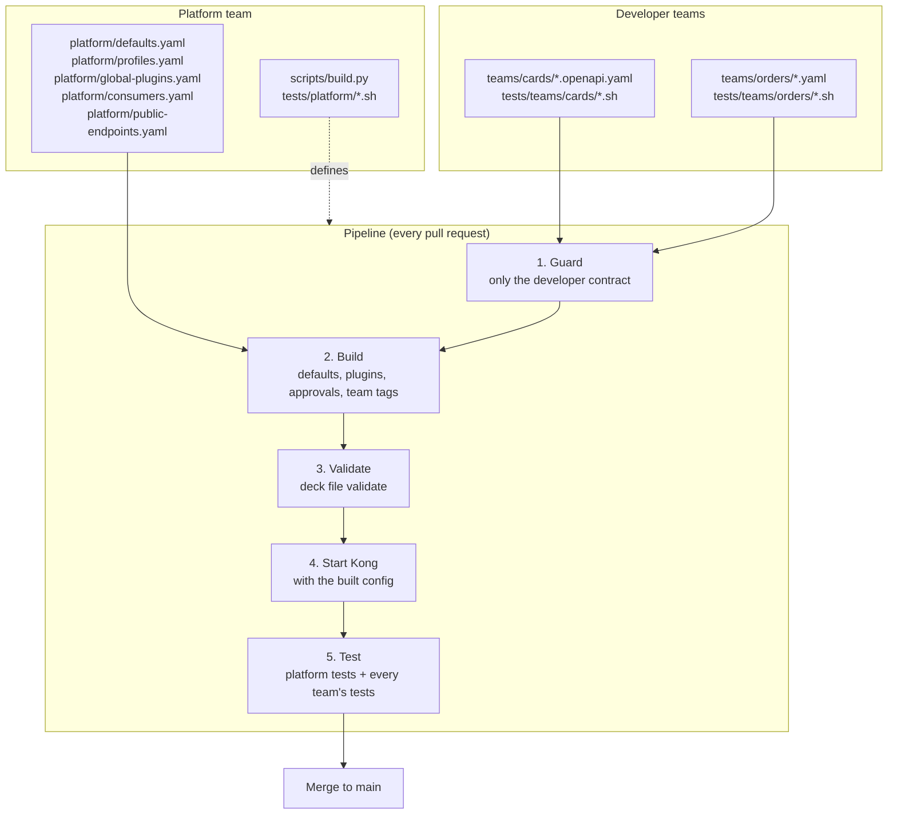

# kong-ci-demo

A demo of a team-friendly API gateway setup on **Kong (free, DB-less)** with a **GitHub Actions** pipeline.

What it shows:

- **A developer needs the minimum** to publish an endpoint: an OpenAPI spec they already have, or three lines of YAML.
- **Developers don't know about plugins, security or governance.** The platform team adds them.
- **Endpoints are private by default.** Making one public needs two keys: the team declares it, and the platform approves it.
- **Only documented operations are reachable.** Anything not in the OpenAPI spec returns 404 at the gateway.
- **The platform changes security for every team at once**, without touching a single team file.
- **Many teams work in parallel** on the same gateway without touching each other's files.
- **Every change is tested on a real Kong** before it reaches `main`.

---

## How it works



1. **Guard:** `build.py` reads every file in `teams/<team>/` and rejects anything outside the developer contract (see below). All problems are reported together, not one at a time.
2. **Build:** OpenAPI specs are converted to routes with `deck file openapi2kong`. Then the platform adds its defaults (timeouts, retries), attaches plugins according to each route's access profile, checks that every public route is approved, adds the global plugins, tags everything with `team:<team>`, and adds the consumers. The result is a single `build/kong.yaml`. It's generated and never committed.
3. **Validate:** decK checks the built file against Kong's schema, offline.
4. **Start Kong:** a fresh DB-less Kong and a test backend ([httpbin](https://github.com/mccutchen/go-httpbin)) start with exactly the config that was built.
5. **Test:** `tests/run.sh` runs the platform guarantees, then every team's tests, against the running Kong.

The pull request can only be merged when every step is green.

---

## Repository layout and ownership

```
teams/
  <team>/*.openapi.yaml     developer team: OpenAPI spec (recommended)
  <team>/*.yaml             developer team: simple form
tests/
  teams/<team>/*.sh         developer team: tests for its endpoints
  platform/*.sh             platform team: guarantees for every service
  lib.sh, run.sh            platform team: test helpers and runner
platform/
  defaults.yaml             platform team: settings for every service and route
  profiles.yaml             platform team: which plugins each access profile gets
  global-plugins.yaml       platform team: plugins on every request
  consumers.yaml            platform team: who may call private routes
  public-endpoints.yaml     security / platform team: which routes may be public
scripts/build.py            platform team: guard and build
.github/workflows/          platform team: the pipeline
docker-compose.yaml         Kong + test backend, used locally and in CI
```

A team only ever touches `teams/<team>/` and `tests/teams/<team>/`. Two teams never edit the same file, so their pull requests never conflict.

---

## For developers: publishing an endpoint

There are two ways to describe endpoints. Use **OpenAPI** if you have a spec; use the **simple form** for something quick.

### Option A: OpenAPI (recommended)

Put your spec in `teams/<your-team>/<name>.openapi.yaml`. The file name must end in `.openapi.yaml`.

```yaml
openapi: 3.0.3
info:
  title: Cards API                       # becomes the service name: cards-api
  version: 1.0.0

servers:
  - url: http://cards-backend:8080       # your backend

security:                                # every operation needs a key...
  - apiKey: []

paths:
  /cards/products:
    get:
      operationId: listCardProducts      # required: names the route
      security: []                       # ...unless it says otherwise: public
      responses:
        "200": { description: OK }

  /cards/{cardId}:
    get:
      operationId: getCard               # no security here: private
      parameters:
        - { name: cardId, in: path, required: true, schema: { type: string } }
      responses:
        "200": { description: OK }

components:
  securitySchemes:
    apiKey: { type: apiKey, in: header, name: apikey }
```

What you get:

- **One route per operation**, with the exact path and method. `GET /cards/{cardId}` matches `/cards/123`, but not `/cards/123/pin`, and not `DELETE /cards/123`. Anything undocumented returns 404 at the gateway.
- **The full path reaches your backend:** `/cards/123` arrives as `/cards/123`.
- **No route-ranking surprises:** decK gives exact paths priority over paths with parameters, so `/cards/products` is never caught by `/cards/{cardId}`.

Rules for the spec:

- `openapi: 3.x`, `servers[0].url` and an `operationId` on every operation are required.
- Operations must be directly under `paths`. An operation indented under `components` by mistake is reported, not silently ignored.
- **No `x-kong-*` extensions** anywhere. They would let a spec add plugins, so they are platform-owned.
- The security *scheme* in your spec is documentation for consumers. How authentication actually works is decided by the platform. The gateway only reads whether an operation is public (`security: []`) or not.

### Option B: the simple form

`teams/<your-team>/<name>.yaml`:

```yaml
services:
  - name: orders
    url: http://orders-backend:8080
    routes:
      - name: orders-api
        paths: [/orders]
        methods: [GET, POST]

      - name: orders-catalog
        paths: [/orders/catalog]
        methods: [GET]
        tags: [access:public]      # declares this route public
```

The contract, the only fields you may write:

| Level | Allowed fields | Required |
|---|---|---|
| file | `services` | |
| service | `name`, `url`, `routes` | `name`, `url` |
| route | `name`, `paths`, `methods`, `tags` | `paths` |

Two Kong behaviours to know about in the simple form (OpenAPI avoids both):

- **The path prefix is removed** before the request reaches the backend. A request to `/status/418` on a route with path `/status` arrives at the backend as `/418`. If the backend expects the prefix, put it in the service URL.
- **More conditions beat a longer path.** If `/orders` has `methods` and `/orders/catalog` doesn't, `GET /orders/catalog` goes to `/orders`. Give overlapping routes the same kinds of conditions.

### Making an endpoint public: two keys

1. **You declare it:** `security: []` on the operation (OpenAPI), or `tags: [access:public]` (simple form).
2. **The platform approves it:** your route is listed in `platform/public-endpoints.yaml`. Use the `operationId` for OpenAPI and the route name for the simple form:

   ```yaml
   public:
     cards:
       - listCardProducts
     orders:
       - orders-catalog
   ```

If you declare public without approval, the build fails:

```
teams/orders/orders.yaml: 'orders-api' is declared public but not approved in platform/public-endpoints.yaml
```

Ask for approval with a pull request that adds your entry. That file is owned by the security / platform team, so they review it.

### What every endpoint gets

| | Private (default) | Public (approved) |
|---|---|---|
| API key required (`apikey` header) | yes | no |
| Rate limit: 60 requests per minute per consumer | yes | no |
| Key removed before reaching the backend | yes | n/a |
| Backend learns the caller (`X-Consumer-Username`) | yes | no |
| Request id on the response (`X-Request-ID`) | yes | yes |
| Platform timeouts and retries | yes | yes |

The platform can change this table at any time. Your files stay the same.

### Testing your endpoints

`tests/teams/<your-team>/test.sh`. The helpers `check`, `status`, `$BASE`, `$ADMIN` and `$KEY` are already available:

```bash
check "products are public"     200 "$(status "$BASE/cards/products")"
check "cards need a key"        401 "$(status "$BASE/cards/123")"
check "card with key works"     200 "$(status -H "apikey: $KEY" "$BASE/cards/123")"
check "undocumented path: 404"  404 "$(status -H "apikey: $KEY" "$BASE/cards/123/pin")"
```

Always test both sides of access: public routes answer without a key, and private routes reject requests without one.

---

## For the platform team

| To change | Edit | Effect |
|---|---|---|
| What "private" or "public" means | `platform/profiles.yaml` | Every route with that profile, across all teams |
| Plugins on every request | `platform/global-plugins.yaml` | Every route of every team |
| Timeouts, retries, protocols | `platform/defaults.yaml` | Every service or route |
| Who may call private routes | `platform/consumers.yaml` | All private routes |
| Which routes may be public | `platform/public-endpoints.yaml` | Approval per team and route |
| What developers may write | the constants at the top of `scripts/build.py` | The developer contract |
| Guarantees checked for every service | `tests/platform/*.sh` | Runs on every pull request |

### Where plugins go

Plugins are never written in team files; the guard rejects them there. Choose the scope by asking *who should it apply to?*

| Scope | File | Use it for | Today |
|---|---|---|---|
| One access profile | `platform/profiles.yaml` | Things that depend on how exposed an endpoint is: authentication, rate limits | `private`: `key-auth`, `rate-limiting` |
| Every request | `platform/global-plugins.yaml` | Things you want everywhere, without exception: request ids, logging, metrics | `correlation-id` |

If the same plugin is set both globally and on a route, Kong uses the route's settings: the more specific one wins.

### Adding a plugin

1. Pick the scope from the table above and add the plugin to that file.
2. Add a test in `tests/platform/` proving it does what it promises.
3. Run everything locally, then open a pull request. Every team's tests run against the change too, so the pipeline shows whether the new plugin breaks any team's endpoints.

Tests that use up a quota should use their own consumer. `rate-limit-probe` exists only so the rate limit test doesn't exhaust `demo-app`'s quota for the team tests that run after it.

### Required repository settings

The ownership above is only enforced if GitHub enforces it. Without these, a developer could approve their own public endpoint by editing `platform/public-endpoints.yaml` in the same pull request.

1. **`.github/CODEOWNERS`**, assigning `platform/`, `scripts/`, `tests/platform/` and `.github/` to the platform team, `platform/public-endpoints.yaml` to the security team, and each `teams/<team>/` and `tests/teams/<team>/` to its team.
2. **Branch protection on `main`:** require a pull request, require review from code owners, and require the `build` and `test` checks to pass.

---

## Run it locally

Requirements: Docker, Python 3 with PyYAML (`pip3 install --user pyyaml`), [decK](https://github.com/Kong/deck) 1.43.1, and `jq`.

```bash
python3 scripts/build.py              # guard + build -> build/kong.yaml
deck file validate build/kong.yaml    # schema check
docker compose up -d --force-recreate kong
./tests/run.sh                        # platform + all team tests
```

Kong listens on `localhost:8000` (proxy) and `localhost:8001` (Admin API). The demo API key is `demo-secret-key`.

Running `./tests/run.sh` many times within a minute can exhaust `demo-app`'s 60 requests, and the team tests then get `429`. That's the rate limit working. Recreating Kong resets the counters. CI always starts a fresh Kong.

---

## Test scenarios: proving it works

Each scenario states a claim, shows how to check it, and what you should see. Scenarios 1–2 run automatically on every pull request. The others are for demonstrating the setup: they change a file on purpose, show the result, and are then undone.

Before each scenario, start from a clean `main` and a passing build. After each one, undo the change with `git checkout -- .` (and delete any new files).

| # | Claim | Kind |
|---|---|---|
| 1 | Every endpoint behaves as declared | automatic |
| 2 | Platform guarantees hold for every team | automatic |
| 3 | A developer needs only the minimum | demo |
| 4 | A developer can't add plugins | guard |
| 5 | A developer can't change platform settings | guard |
| 6 | Public needs platform approval | guard |
| 7 | Only documented operations are reachable | demo |
| 8 | An OpenAPI spec can't smuggle in plugins | guard |
| 9 | One line can't expose a whole API | guard |
| 10 | Mistakes in a spec are reported, not ignored | guard |
| 11 | Teams can't collide | guard |
| 12 | The platform changes all teams at once | demo |
| 13 | Kong itself rejects invalid plugin config | pipeline |
| 14 | Teams work in parallel without conflicts | demo |

### 1. Every endpoint behaves as declared (automatic)

```bash
python3 scripts/build.py
docker compose up -d --force-recreate kong
./tests/run.sh
```

Expected: one section per team (`== cards`, `== demo`, `== orders`), every line `PASS`, exit code `0`. The same runs in CI on every pull request.

### 2. Platform guarantees hold for every team (automatic)

In the output of scenario 1, the `== platform` section checks **every** service, including ones no platform test mentions by name:

```
== platform
  PASS  cards-api: platform timeout
  PASS  cards-api: has a team tag
  ...
  PASS  limit trips with 429
```

A new team's service appears here automatically, without anyone writing a test for it.

### 3. A developer needs only the minimum

Add an endpoint with nothing but a name, a backend and a path, in `teams/orders/orders.yaml`:

```yaml
      - name: orders-history
        paths: [/orders/history]
        methods: [GET]
```

```bash
python3 scripts/build.py && docker compose up -d --force-recreate kong && sleep 3
curl -s -o /dev/null -w '%{http_code}\n' localhost:8000/orders/history
curl -s -o /dev/null -w '%{http_code}\n' -H "apikey: demo-secret-key" localhost:8000/orders/history
curl -si -H "apikey: demo-secret-key" localhost:8000/orders/history | grep -iE "ratelimit-limit|x-request-id"
```

Expected: `401`, then `200`, then rate limit and request id headers. Key authentication, rate limiting and the request id were all added by the platform; the developer wrote none of it.

### 4. A developer can't add plugins

Add a plugin to a route in `teams/demo/echo.yaml`:

```yaml
      - name: private-route
        paths: [/private]
        plugins:
          - name: cors
```

```bash
python3 scripts/build.py
```

Expected:

```
Guard failed:
  teams/demo/echo.yaml: route 'private-route': 'plugins' is not allowed (platform-owned)
```

### 5. A developer can't change platform settings

Add `read_timeout: 999999` under `url:` in `teams/demo/echo.yaml`, then run `python3 scripts/build.py`.

Expected:

```
  teams/demo/echo.yaml: service 'echo': 'read_timeout' is not allowed (platform-owned)
```

### 6. Public needs platform approval

Declare the private `orders-api` route public in `teams/orders/orders.yaml`:

```yaml
      - name: orders-api
        paths: [/orders]
        methods: [GET, POST]
        tags: [access:public]
```

```bash
python3 scripts/build.py
```

Expected:

```
  teams/orders/orders.yaml: 'orders-api' is declared public but not approved in platform/public-endpoints.yaml
```

Now add `- orders-api` under `orders:` in `platform/public-endpoints.yaml` and build again: it passes. Both keys are needed. With the required repository settings, that second change can't be merged without the security team's review.

### 7. Only documented operations are reachable

The cards spec documents `GET /cards/{cardId}`, nothing else on that path.

```bash
curl -s -o /dev/null -w '%{http_code}\n' -H "apikey: demo-secret-key" localhost:8000/cards/123
curl -s -o /dev/null -w '%{http_code}\n' -H "apikey: demo-secret-key" -X DELETE localhost:8000/cards/123
curl -s -o /dev/null -w '%{http_code}\n' -H "apikey: demo-secret-key" localhost:8000/cards/123/pin
```

Expected: `200`, `404`, `404`. Even with a valid key, an undocumented method or path never reaches the backend.

### 8. An OpenAPI spec can't smuggle in plugins

Add a Kong extension to an operation in `teams/cards/cards.openapi.yaml`:

```yaml
  /cards/{cardId}:
    get:
      operationId: getCard
      x-kong-plugin-request-termination:
        config: { status_code: 200 }
```

```bash
python3 scripts/build.py
```

Expected:

```
  teams/cards/cards.openapi.yaml: 'spec.paths./cards/{cardId}.get.x-kong-plugin-request-termination': Kong extensions are platform-owned
```

### 9. One line can't expose a whole API

In `teams/cards/cards.openapi.yaml`, change the global security to public:

```yaml
security: []
```

```bash
python3 scripts/build.py
```

Expected: one error per operation that isn't approved:

```
  teams/cards/cards.openapi.yaml: 'listCards' is declared public but not approved in platform/public-endpoints.yaml
  teams/cards/cards.openapi.yaml: 'getCard' is declared public but not approved in platform/public-endpoints.yaml
```

### 10. Mistakes in a spec are reported, not ignored

Move the `/cards:` block (with its `get:`) below `components:` in `teams/cards/cards.openapi.yaml`, as if it had been pasted at the end of the file. It's still valid YAML, but no longer an operation.

```bash
python3 scripts/build.py
```

Expected:

```
  teams/cards/cards.openapi.yaml: '/cards' is under 'components', not under 'paths' - check its indentation
```

Without this check, the endpoint would silently disappear and only show up later as a 404.

### 11. Teams can't collide

Create `teams/payments/payments.yaml` reusing another team's service name:

```yaml
services:
  - name: orders
    url: http://httpbin:8080
    routes:
      - name: pay
        paths: [/pay]
```

```bash
python3 scripts/build.py
```

Expected:

```
  teams/payments/payments.yaml: name 'orders' already used in teams/orders/orders.yaml
```

### 12. The platform changes all teams at once

Add a global plugin to `platform/global-plugins.yaml`:

```yaml
  - name: response-transformer
    config:
      add:
        headers:
          - "X-Platform:kong-ci-demo"
```

```bash
python3 scripts/build.py && docker compose up -d --force-recreate kong && sleep 3
curl -si localhost:8000/cards/products | grep -i x-platform
curl -si localhost:8000/echo/get | grep -i x-platform
curl -si -H "apikey: demo-secret-key" localhost:8000/orders | grep -i x-platform
git status --short teams/
```

Expected: `X-Platform: kong-ci-demo` on all three teams' endpoints, and `git status` shows **no changes in `teams/`**.

### 13. Kong itself rejects invalid plugin config

In `platform/profiles.yaml`, misspell a plugin: `name: key-authh`. The guard and `deck file validate` don't know plugin names, so the build passes. Push it on a branch and open a pull request.

Expected: the `build` job is green, the `test` job fails at "Wait until Kong is ready", and the Kong log printed at the end names `key-authh`. This is why the pipeline tests on a real Kong and doesn't rely only on static checks.

Locally, `docker compose up -d --force-recreate kong` followed by `docker compose logs kong | tail` shows the same error.

### 14. Teams work in parallel without conflicts

1. From the same `main`, create two branches: one adds an endpoint in `teams/orders/` and `tests/teams/orders/`, the other in `teams/cards/` and `tests/teams/cards/`.
2. Push both and open two pull requests.
3. Merge the first one.

Expected: the second pull request still shows "This branch has no conflicts with the base branch", because the two teams share no files. Both pipelines are green, and after merging both, `./tests/run.sh` on `main` shows every team passing.

---

## Notes

- The API keys in `platform/consumers.yaml` are for the demo only. Real keys never belong in git.
- `build/` is generated and listed in `.gitignore`.
- `rate-limiting` uses `policy: local`: counters live in each Kong node. With several nodes, use a shared store such as Redis, or each node enforces its own limit.
- Kong runs **DB-less**: the whole config is loaded from one file at startup, and the Admin API is read-only.